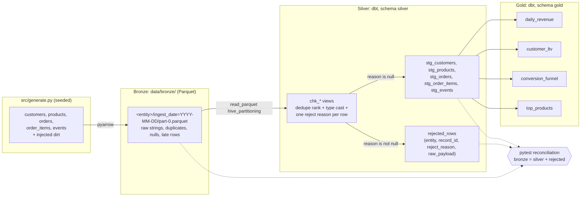
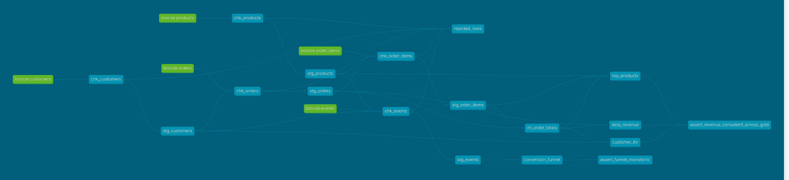

# ecom-lakehouse

**A production-style ELT pipeline that takes messy e-commerce data through a bronze → silver → gold
medallion lakehouse, proves no row is lost along the way, and rebuilds and tests everything in about 30 seconds on a laptop.**

[](https://github.com/Suryadevo7/suryadev-ecom-lakehouse/actions/workflows/ci.yml)
[](https://suryadevo7.github.io/suryadev-ecom-lakehouse/)


[](LICENSE)

| | |
|---|---|
| **Data volume (default)** | ~84,000 raw rows across 5 entities, scales with `ROWS=` |
| **Dirt injected** | 9 kinds: duplicates, nulls, bad dates, negative prices, bad quantities, orphan keys, invalid events, messy casing, late arrivals |
| **Quality gates** | **113 automated tests** (67 dbt data tests + 46 pytest), ruff lint, exact row-level reconciliation |
| **Runtime** | ~30 s from an empty folder (venv, data, warehouse, tests); dbt models build in ~1 s |
| **Runs on** | Linux and Windows (Makefile or PowerShell), both verified in CI on every push |
| **Docs** | [Live dbt docs + lineage graph](https://suryadevo7.github.io/suryadev-ecom-lakehouse/), rebuilt on every push to `main` |

## Why this project exists

Real source systems send data that is duplicated, late, malformed and inconsistent. A data
platform's job is to turn that into tables analysts can trust, **and to prove it did so
without silently losing or inventing rows**. This repo is a self-contained, end-to-end example
of that job:

1. **Ingest** raw data unchanged into a bronze landing zone (Parquet, partitioned by arrival date).
2. **Validate** every row in silver: clean rows go to typed tables, bad rows go to a quarantine table with the reason.
3. **Model** business metrics in gold: revenue, customer lifetime value, conversion funnel, product rankings.
4. **Prove** correctness automatically: every raw row is in exactly one place, and the metrics agree with each other.

## What this demonstrates

- **Data modelling with dbt:** sources, staging, ephemeral intermediates and marts; custom schemas; Jinja macros; generic and singular tests; documentation and lineage.
- **Data quality engineering:** deterministic dedupe, safe type casting, referential integrity with cascading rejects, a quarantine table with reasons, and row-level reconciliation.
- **Lakehouse fundamentals:** columnar Parquet, hive partitioning, the bronze/silver/gold medallion pattern, late-arriving data handled on business time.
- **Python engineering:** a vectorised NumPy/PyArrow generator, reproducibility by seed (byte-identical output), a CLI, and pytest with fixtures and parametrisation.
- **DevOps for data:** one-command builds, pinned dependencies, a lint gate, cross-platform CI, and docs auto-deployed to GitHub Pages.

## Architecture



The real dependency graph, generated by dbt ([explore it interactively](https://suryadevo7.github.io/suryadev-ecom-lakehouse/)):



Everything lands in a single DuckDB file, `data/lakehouse.duckdb` (gitignored, rebuilt on demand).

## Quick start

Requirements: **Python 3.13** and **GNU make**. On Windows, use Git Bash, or the bundled
`make.ps1` (see below).

```bash
git clone https://github.com/Suryadevo7/suryadev-ecom-lakehouse.git ecom-lakehouse && cd ecom-lakehouse
make all                 # setup -> generate -> run -> test
```

| target | what it does |
|---|---|
| `make setup` | create `.venv` and install pinned `requirements.txt` (re-runs only when requirements change) |
| `make lint` | `ruff check` + `ruff format --check` |
| `make generate` | write bronze Parquet to `data/bronze/` (`ROWS=10000 SEED=42` by default) |
| `make run` | `dbt run`: build silver and gold into `data/lakehouse.duckdb` |
| `make test` | `dbt test` (67 data tests) + `pytest` (generator unit tests + reconciliation) |
| `make docs` | generate the dbt docs site (`dbt/target/static_index.html`) |
| `make all` | setup → lint → generate → run → test. This is what CI runs |
| `make clean` / `make distclean` | remove generated data / also remove the venv |

Change the data volume or seed:

```bash
make all ROWS=500 SEED=7
```

**Windows (PowerShell, no make):**

```powershell
.\make.ps1 all
.\make.ps1 generate -Rows 500 -Seed 7
```

Explore the warehouse afterwards:

```bash
.venv/bin/python scripts/sample_queries.py      # Windows: .venv\Scripts\python scripts\sample_queries.py
```

## Project layout

```text
src/generate.py                 synthetic data generator -> bronze Parquet
dbt/
  dbt_project.yml, profiles.yml repo-local profile (no ~/.dbt needed)
  macros/                       safe_ts(), dedupe_rank(), schema naming, generic tests
  models/silver/_sources.yml    bronze Parquet registered as dbt sources
  models/silver/checks/chk_*    validation views: one reject reason per bronze row
  models/silver/stg_*           clean, typed, deduplicated tables
  models/silver/rejected_rows   quarantine with reason + original row as JSON
  models/gold/                  daily_revenue, customer_ltv, conversion_funnel, top_products
  tests/                        singular tests (cross-model revenue, funnel monotonicity)
tests/test_generate.py          pytest: determinism, CLI, schema, partitions, dirt present
tests/test_reconciliation.py    pytest: bronze = silver + rejected, by count and by record id
scripts/sample_queries.py       the queries behind the outputs below
docs/images/                    lineage graph screenshot
ruff.toml                       lint configuration
Makefile, make.ps1              orchestration (bash / PowerShell)
.github/workflows/ci.yml        make all (ubuntu) + make.ps1 all (windows) on every push; dbt docs -> GitHub Pages
```

## The data and its dirt

`--rows` is the number of orders. Other entities scale from it: customers = rows/5,
products = rows/50, sessions = rows×2 (≈4.5 events per order). Business dates span
2025-01-01 → 2025-03-31.

| dirt | where | how silver handles it |
|---|---|---|
| duplicates (re-deliveries, some with an updated email) | all entities, ~3% | keep the newest by `ingest_date`, `_record_id`; others → `duplicate` |
| missing required fields | email, order customer, product price, item order, session id | → `null_required_field` |
| bad dates: `2025-02-30`, `31/12/2025`, `not-a-date`, `''`, `2099-…` | signup, order and event timestamps | `try_cast` + sanity window → `invalid_date` |
| negative prices | products, order_items | → `negative_price` |
| zero/negative quantities | order_items | → `invalid_quantity` |
| unknown event types (`click??`, `page-vue`) | events | → `invalid_event_type` |
| orphan foreign keys | orders→customers, items→orders/products, events→customers/products | → `orphan_fk` (cascades, see below) |
| messy casing/whitespace (` DELIVERED `, `Page_View`) | order status, event type | normalised with `lower(trim())`, **kept** |
| late-arriving records | orders, items, events (days late); customers (weeks late) | **kept**; counted on business date, flagged `is_late_arriving` |

## Sample query outputs

Real output from `make all` with defaults (`ROWS=10000 SEED=42`), via
`scripts/sample_queries.py`. Because the generator is deterministic, you get the same numbers.

**Where did bronze rows go? (reconciliation)**

```text
┌─────────────┬────────┬────────┬──────────┬────────────┐
│   entity    │ bronze │ silver │ rejected │ reconciled │
│   varchar   │ int64  │ int64  │  int64   │  boolean   │
├─────────────┼────────┼────────┼──────────┼────────────┤
│ products    │    206 │    193 │       13 │ true       │
│ customers   │   2047 │   1932 │      115 │ true       │
│ orders      │  10302 │   9177 │     1125 │ true       │
│ order_items │  25754 │  20874 │     4880 │ true       │
│ events      │  45629 │  40132 │     5497 │ true       │
└─────────────┴────────┴────────┴──────────┴────────────┘
```

**Rejected rows by reason**

```text
┌─────────────────────┬───────┬──────────────────────────────────────────────────┐
│    reject_reason    │ rows  │                     entities                     │
│       varchar       │ int64 │                     varchar                      │
├─────────────────────┼───────┼──────────────────────────────────────────────────┤
│ orphan_fk           │  5484 │ events, order_items, orders                      │
│ duplicate           │  2404 │ customers, events, order_items, orders, products │
│ null_required_field │  1572 │ customers, events, order_items, orders, products │
│ invalid_date        │  1050 │ customers, events, orders                        │
│ negative_price      │   457 │ order_items, products                            │
│ invalid_event_type  │   444 │ events                                           │
│ invalid_quantity    │   219 │ order_items                                      │
└─────────────────────┴───────┴──────────────────────────────────────────────────┘
```

**gold.daily_revenue (first 7 days)**

```text
┌────────────┬────────┬────────────┬───────────────┬─────────────────┬──────────────────────┐
│ order_date │ orders │ units_sold │    revenue    │ avg_order_value │ late_arriving_orders │
│    date    │ int64  │   int64    │ decimal(14,2) │  decimal(14,2)  │        int64         │
├────────────┼────────┼────────────┼───────────────┼─────────────────┼──────────────────────┤
│ 2025-01-01 │    100 │        723 │      26785.26 │          267.85 │                    8 │
│ 2025-01-02 │     90 │        702 │      23309.30 │          258.99 │                    9 │
│ 2025-01-03 │     75 │        414 │      16440.55 │          219.21 │                    5 │
│ 2025-01-04 │     98 │        717 │      26144.99 │          266.79 │                    6 │
│ 2025-01-05 │     93 │        698 │      22452.30 │          241.42 │                    7 │
│ 2025-01-06 │     94 │        634 │      23006.92 │          244.75 │                    5 │
│ 2025-01-07 │     93 │        645 │      19599.99 │          210.75 │                    6 │
└────────────┴────────┴────────────┴───────────────┴─────────────────┴──────────────────────┘
```

**gold.customer_ltv (segments)**

```text
┌─────────────┬───────────┬─────────┬────────────┐
│ ltv_segment │ customers │ avg_ltv │ avg_orders │
│   varchar   │   int64   │ double  │   double   │
├─────────────┼───────────┼─────────┼────────────┤
│ high        │       780 │ 1523.73 │       5.71 │
│ mid         │       766 │  696.45 │       3.68 │
│ low         │       345 │  235.41 │       2.01 │
│ none        │        41 │     0.0 │       0.02 │
└─────────────┴───────────┴─────────┴────────────┘
```

**gold.conversion_funnel (whole window)**

```text
┌──────────────┬──────────┬─────────────────────┐
│    stage     │ sessions │ conversion_from_top │
│   varchar    │  int128  │       double        │
├──────────────┼──────────┼─────────────────────┤
│ page_view    │    19079 │                 1.0 │
│ product_view │    11005 │              0.5768 │
│ add_to_cart  │     5606 │              0.2938 │
│ checkout     │     3349 │              0.1755 │
│ purchase     │     2239 │              0.1174 │
└──────────────┴──────────┴─────────────────────┘
```

**gold.top_products (top 5)**

```text
┌──────────────┬───────────────────────┬─────────────┬────────────┬───────────────┐
│ revenue_rank │     product_name      │  category   │ units_sold │    revenue    │
│    int64     │        varchar        │   varchar   │   int64    │ decimal(14,2) │
├──────────────┼───────────────────────┼─────────────┼────────────┼───────────────┤
│            1 │ Electronics Item 0157 │ electronics │        302 │      55667.66 │
│            2 │ Electronics Item 0161 │ electronics │        304 │      50308.96 │
│            3 │ Beauty Item 0145      │ beauty      │        272 │      45989.76 │
│            4 │ Beauty Item 0011      │ beauty      │        276 │      34610.40 │
│            5 │ Sports Item 0197      │ sports      │        398 │      33014.10 │
└──────────────┴───────────────────────┴─────────────┴────────────┴───────────────┘
```

## Tests

| layer | tool | what is checked |
|---|---|---|
| generator | pytest (34) | same seed ⇒ byte-identical Parquet; different seed differs; reruns overwrite; `--rows` controls order count; CLI; schema; hive partition layout; every type of dirt is present; late records exist |
| silver | dbt (39) | `unique` / `not_null` on every key; `relationships` for all FKs; `accepted_values` for status, event type, category, country, entity, reject reason; prices ≥ 0, quantity > 0; `(entity, record_id)` unique in quarantine |
| gold | dbt (28) | keys unique / not null, `relationships` back to silver, `accepted_values` for segment and stage, non-negative metrics; **revenue identical across daily_revenue, customer_ltv and top_products**; **funnel monotonic** |
| reconciliation | pytest (12) | per entity, `count(bronze) = count(stg) + count(rejected)`; the `_record_id` sets are disjoint and their union is exactly bronze; every reject reason fires; late orders reach silver |

Both kinds of test were checked by deliberately breaking the pipeline: letting all
bronze orders through `stg_orders` fails 4 dbt tests (unique, not_null, relationships,
accepted_values), and silently dropping 1% of orders fails both reconciliation tests.

## Design decisions

- **Partition bronze by ingestion date, not business date.** That is what a landing zone
  actually looks like: an order from Jan 3 delivered on Jan 9 lives in
  `ingest_date=2025-01-09`. It keeps bronze append-only and makes late arrivals explicit.
  Silver and gold work on business dates, so late records are counted on the right day
  (`daily_revenue.late_arriving_orders` shows how many).
- **Keep bronze raw.** Dates are strings in bronze, so `2025-02-30` survives ingestion and
  is caught in silver. Casting at write time would silently turn bad values into nulls
  and lose the evidence.
- **One row, one destination, one reason.** Each `chk_*` view assigns at most one
  `reject_reason` with a fixed precedence (`duplicate` → `null_required_field` →
  `invalid_date` → value checks → `orphan_fk`). `stg_*` takes the rows with no reason and
  `rejected_rows` takes the rest. That is why reconciliation is an exact equality, and
  why it is checked on `_record_id` sets, not just counts.
- **Duplicates are quarantined, not dropped.** The losing copies go to `rejected_rows`
  with reason `duplicate`, so nothing disappears unexplained. The newest delivery wins,
  which lets a re-sent customer with an updated email override the old one.
- **FK checks cascade.** An order is valid only if its customer survived silver, and an
  item only if its order and product did. This is why `orphan_fk` is the largest reject
  bucket: rejecting about 11% of orders also quarantines their items. Gold never has to
  defend against dangling keys, and the `relationships` tests prove it.
- **Nullable is not the same as missing.** `events.customer_id` is null for anonymous
  visitors and `product_id` is null on page views. Those are valid. Only *present but
  unknown* keys are orphans.
- **Normalise what is recoverable.** Casing and whitespace in status and event type are
  fixed. Values that cannot be fixed (`click??`) are quarantined.
- **Funnel by deepest stage reached.** A session counts toward every stage up to its
  deepest valid event, so the funnel stays monotonic even when a middle event was
  quarantined. A singular test enforces it.
- **Deterministic everything.** `numpy.random.default_rng(seed)`, a fixed date window,
  no wall-clock reads, a stable sort before assigning `_record_id`, and one file per
  partition. The same inputs always produce byte-identical bronze, and the date sanity
  window is a dbt var rather than `current_date`, so results do not drift over time.
- **No external dbt packages.** The three generic tests that would normally come from
  `dbt_utils` are 5-line macros in `dbt/macros/tests/`, so `dbt deps` and network access
  are not needed.
- **Full refresh, not incremental.** At this size a full rebuild takes about a second and
  removes a whole class of state bugs. Moving to `materialized='incremental'` keyed on
  `ingest_date` is the natural next step for real volumes.
- **Pinned toolchain.** Python 3.13, `dbt-core==1.12.7`, `dbt-duckdb==1.11.1`,
  `duckdb==2.0.1`, `pyarrow==26.0.1`, `numpy==2.5.5`, `pytest==9.2.0`.

## Taking it to production

The design maps directly onto a cloud stack. Here is what would change, and what would not:

| concern | here | in production |
|---|---|---|
| storage | local Parquet | S3 / ADLS / GCS with the same hive layout, or Delta / Iceberg tables |
| compute | DuckDB | Snowflake, BigQuery, Databricks or Postgres: swap the dbt adapter, keep the models |
| orchestration | `make` | Airflow, Dagster or Prefect calling the same `generate → run → test` steps |
| loading | full refresh | `incremental` models keyed on `ingest_date`, with late-data lookback windows |
| quality | dbt tests + reconciliation | the same, plus freshness checks, anomaly alerts and a dashboard over `rejected_rows` |
| ingestion | synthetic generator | CDC / API extractors writing to the same bronze contract |

## License

[MIT](LICENSE)
